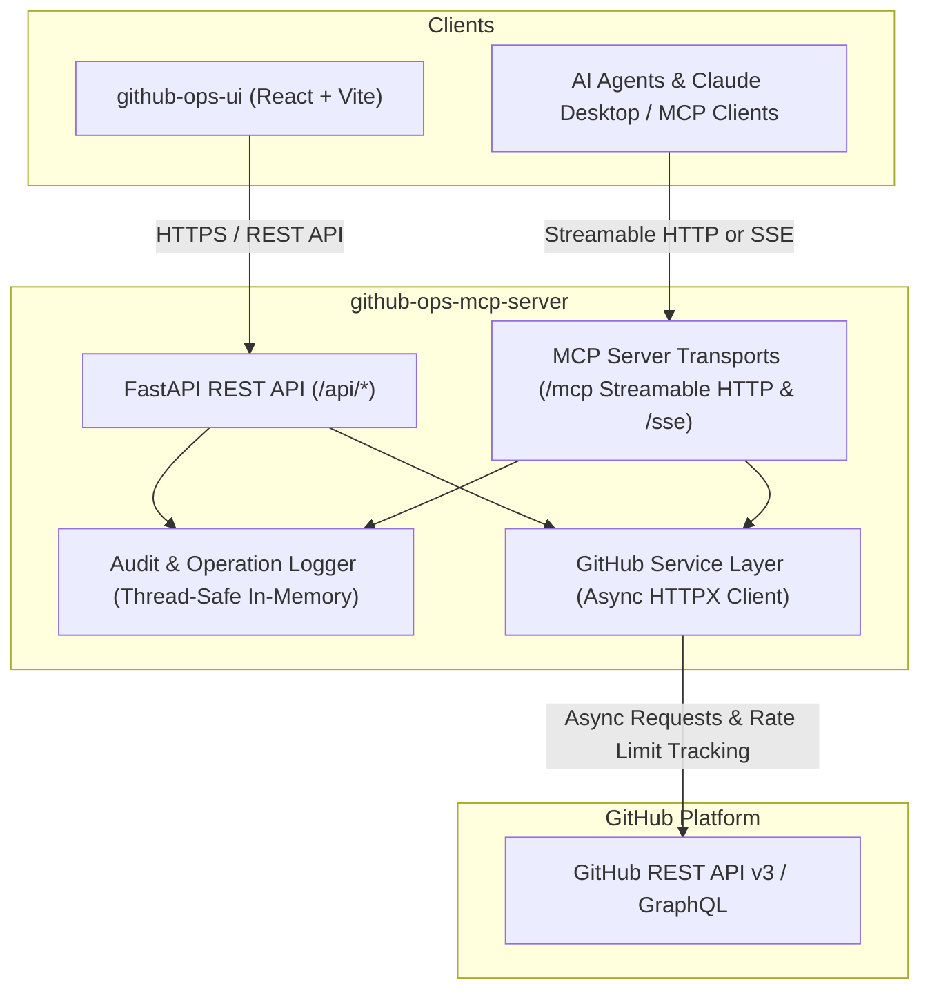

# GitHub Operations MCP Server & FastAPI Backend

A production-ready Python backend providing **Model Context Protocol (MCP)** tools and **FastAPI REST endpoints** for end-to-end GitHub operations management.

[](https://github.com/ravi-kundu7284/github-ops-mcp-server/actions)
[](https://www.python.org/downloads/)
[](https://modelcontextprotocol.io/)
[](https://fastapi.tiangolo.com)
[](LICENSE)

---

## Architecture Overview



---

## Features

- **22 Model Context Protocol (MCP) Tools:** Exposing standard MCP tool schemas over Streamable HTTP and SSE transports.
- **FastAPI REST API:** Fully typed endpoints matching all UI operations with Pydantic v2 schemas and OpenAPI documentation at `/api/docs`.
- **Async Service Layer:** High-performance async GitHub client using HTTPX with automatic token injection, timeout handling, and rate limit inspection.
- **Audit Logging:** In-memory ring buffer recording every REST call and MCP tool call (status, duration, sanitized parameters, errors).
- **Safety Protections:** Destructive operations like repository deletion require explicit verification challenge matching the repository name.
- **Security:** Token extraction from headers (`X-GitHub-Token` or `Authorization: Bearer`), optional backend API key enforcement, and sanitized logging.

---

## MCP Tools Reference

The server exposes 22 official MCP tools conforming to the Model Context Protocol specification:

| Tool Name | Parameters | Description |
|-----------|------------|-------------|
| `list_repositories` | `visibility`, `sort`, `direction`, `per_page`, `page` | List repositories accessible to the user |
| `get_repository` | `owner`, `repo` | Retrieve repository metadata and settings |
| `create_repository` | `name`, `description`, `private`, `auto_init` | Create a new GitHub repository |
| `update_repository` | `owner`, `repo`, `name`, `description`, `private` | Update repository name, description, or visibility |
| `delete_repository` | `owner`, `repo`, `confirm` | Delete a repository (**confirm=True required**) |
| `list_branches` | `owner`, `repo`, `per_page`, `page` | List branches for a repository |
| `create_branch` | `owner`, `repo`, `branch`, `from_branch` | Create a new branch from a source branch/SHA |
| `list_pull_requests` | `owner`, `repo`, `state`, `sort`, `direction`, `per_page`, `page` | List pull requests |
| `create_pull_request` | `owner`, `repo`, `title`, `head`, `base`, `body`, `draft` | Create a new pull request |
| `review_pull_request` | `owner`, `repo`, `pull_number`, `event`, `body` | Submit a PR review (`APPROVE`, `REQUEST_CHANGES`, `COMMENT`) |
| `merge_pull_request` | `owner`, `repo`, `pull_number`, `commit_title`, `commit_message`, `merge_method` | Merge PR (`merge`, `squash`, `rebase`) |
| `list_issues` | `owner`, `repo`, `state`, `labels`, `sort`, `direction`, `per_page`, `page` | List issues (excluding pull requests) |
| `create_issue` | `owner`, `repo`, `title`, `body`, `assignees`, `labels` | Create a new issue |
| `update_issue` | `owner`, `repo`, `issue_number`, `title`, `body`, `state`, `assignees`, `labels` | Update an issue |
| `close_issue` | `owner`, `repo`, `issue_number`, `comment` | Close an issue with optional comment |
| `list_commits` | `owner`, `repo`, `sha`, `path`, `author`, `per_page`, `page` | List commit history |
| `get_file_contents` | `owner`, `repo`, `path`, `ref` | Read file or list directory contents |
| `create_or_update_file` | `owner`, `repo`, `path`, `message`, `content`, `sha`, `branch` | Create or update file with commit message |
| `list_workflows` | `owner`, `repo` | List GitHub Actions workflows |
| `get_workflow_runs` | `owner`, `repo`, `workflow_id`, `status`, `per_page`, `page` | Get workflow execution history |
| `get_workflow_run_logs` | `owner`, `repo`, `run_id` | Get jobs and logs for workflow run |
| `search_github` | `query`, `search_type`, `per_page`, `page` | Search repos, issues, PRs, commits, code, users |

---

## REST API Endpoints

- **Health & Info:**
  - `GET /health` / `GET /api/health` - Service health status
  - `GET /api/mcp/info` - MCP tools and transport information
  - `GET /api/auth/status` - Current GitHub user info & token validity
  - `GET /api/auth/ratelimit` - Rate limit quotas (limit, remaining, reset)
- **Operations & Audit:**
  - `GET /api/operations` - List recent audit records (filters: `limit`, `channel`, `status`)
  - `DELETE /api/operations` - Clear audit records
- **Repositories:**
  - `GET /api/repos` - List repositories
  - `POST /api/repos` - Create repository
  - `GET /api/repos/{owner}/{repo}` - Repository details
  - `PATCH /api/repos/{owner}/{repo}` - Update repository
  - `DELETE /api/repos/{owner}/{repo}` - Delete repository (requires `confirm=repo_name`)
- **Branches:**
  - `GET /api/repos/{owner}/{repo}/branches` - List branches
  - `POST /api/repos/{owner}/{repo}/branches` - Create branch
- **Pull Requests:**
  - `GET /api/repos/{owner}/{repo}/pulls` - List PRs
  - `POST /api/repos/{owner}/{repo}/pulls` - Create PR
  - `GET /api/repos/{owner}/{repo}/pulls/{number}` - PR details
  - `POST /api/repos/{owner}/{repo}/pulls/{number}/reviews` - Submit review
  - `PUT /api/repos/{owner}/{repo}/pulls/{number}/merge` - Merge PR
- **Issues:**
  - `GET /api/repos/{owner}/{repo}/issues` - List issues
  - `POST /api/repos/{owner}/{repo}/issues` - Create issue
  - `GET /api/repos/{owner}/{repo}/issues/{number}` - Issue details
  - `PATCH /api/repos/{owner}/{repo}/issues/{number}` - Update issue
  - `POST /api/repos/{owner}/{repo}/issues/{number}/close` - Close issue
- **Commits:**
  - `GET /api/repos/{owner}/{repo}/commits` - Commit history
  - `GET /api/repos/{owner}/{repo}/commits/{sha}` - Commit details & diff
- **Files & Contents:**
  - `GET /api/repos/{owner}/{repo}/contents/{path}` - Read file or list directory
  - `PUT /api/repos/{owner}/{repo}/contents/{path}` - Create or update file
- **Workflows:**
  - `GET /api/repos/{owner}/{repo}/actions/workflows` - List workflows
  - `GET /api/repos/{owner}/{repo}/actions/runs` - Workflow runs
  - `GET /api/repos/{owner}/{repo}/actions/runs/{run_id}/logs` - Run jobs and logs
- **Search:**
  - `GET /api/search?q={query}&type={type}` - Search across GitHub

---

## Environment Variables

| Variable | Default | Description |
|----------|---------|-------------|
| `GITHUB_TOKEN` | *None* | Default GitHub Personal Access Token (classic or fine-grained) |
| `GITHUB_API_URL` | `https://api.github.com` | Base GitHub REST API URL |
| `APP_HOST` | `0.0.0.0` | Host binding for server |
| `APP_PORT` | `8000` | Port binding |
| `ENVIRONMENT` | `development` | Deployment environment |
| `LOG_LEVEL` | `INFO` | Logging verbosity |
| `CORS_ORIGINS` | `http://localhost:5173,http://localhost:3000` | Comma-separated list of allowed origins |
| `API_KEY` | *None* | Optional API Key for securing backend endpoints |
| `MCP_SERVER_NAME`| `github-ops-mcp-server` | MCP Server identification |
| `MAX_AUDIT_LOGS` | `500` | In-memory audit buffer size |

---

## Local Development

### 1. Prerequisites
- Python 3.11 or Python 3.12
- [uv](https://github.com/astral-sh/uv) (recommended) or standard `venv` + `pip`

### 2. Setup Virtual Environment
```bash
# Using uv (fastest):
uv venv .venv
# On Windows:
.venv\Scripts\activate
# On Linux/macOS:
source .venv/bin/activate

# Install dependencies:
uv pip install -r requirements-dev.txt
```

### 3. Configure Environment
```bash
cp .env.example .env
# Edit .env and supply your GITHUB_TOKEN
```

### 4. Run the Server
```bash
python -m uvicorn app.main:app --host 0.0.0.0 --port 8000 --reload
```
Open [http://localhost:8000/api/docs](http://localhost:8000/api/docs) to view interactive Swagger documentation.

### 5. Run Tests and Linters
```bash
# Run Pytest suite
pytest -v

# Run Ruff linter
ruff check app tests
```

---

## Connecting MCP Clients (Claude Desktop, Cursor)

### Streamable HTTP Transport
Add to your client configuration:
```json
{
  "mcpServers": {
    "github-ops": {
      "url": "http://localhost:8000/mcp"
    }
  }
}
```

### SSE Transport
```json
{
  "mcpServers": {
    "github-ops": {
      "url": "http://localhost:8000/sse"
    }
  }
}
```

---

## Docker Deployment

### Build and Run with Docker
```bash
docker build -t github-ops-mcp-server .
docker run -p 8000:8000 --env GITHUB_TOKEN=ghp_your_token github-ops-mcp-server
```

---

## Production Deployment Checklist

1. **GitHub Token Permissions:** Use fine-grained personal access tokens or GitHub App tokens granting minimal required permissions (e.g. Repository read/write, Actions read, Issues read/write).
2. **CORS:** Set `CORS_ORIGINS` to your production frontend domain (e.g. `https://github-ops-ui.pages.dev`).
3. **API Key:** Set `API_KEY` to protect endpoints if the backend is exposed publicly.
4. **HTTPS:** Terminate TLS via Cloud Run, Render, or a reverse proxy (e.g. NGINX / Caddy).
5. **Health Checks:** Configure container orchestrators to probe `/health`.
