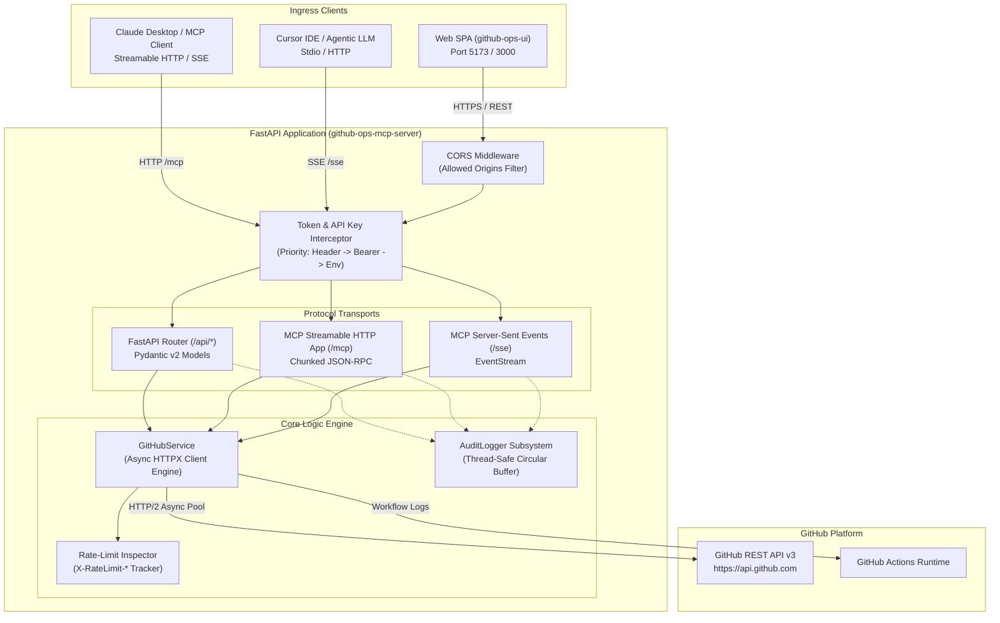
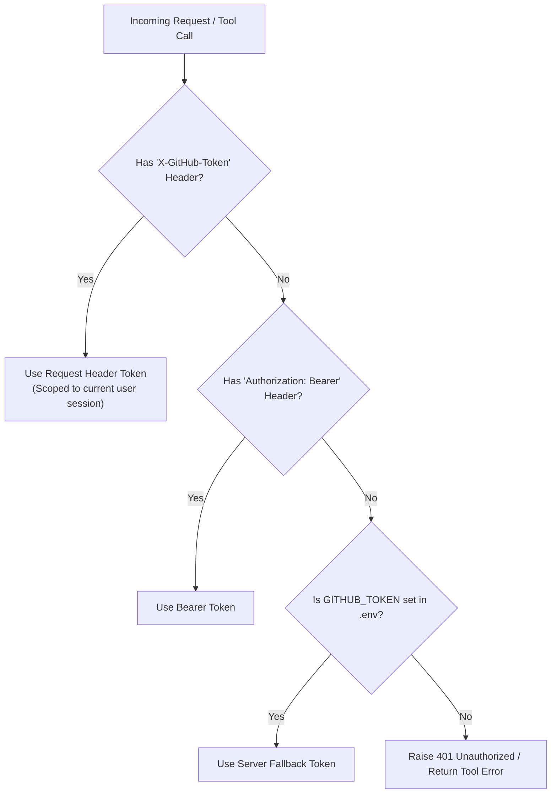
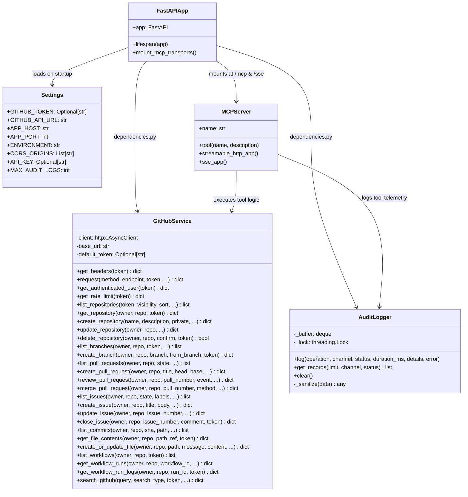
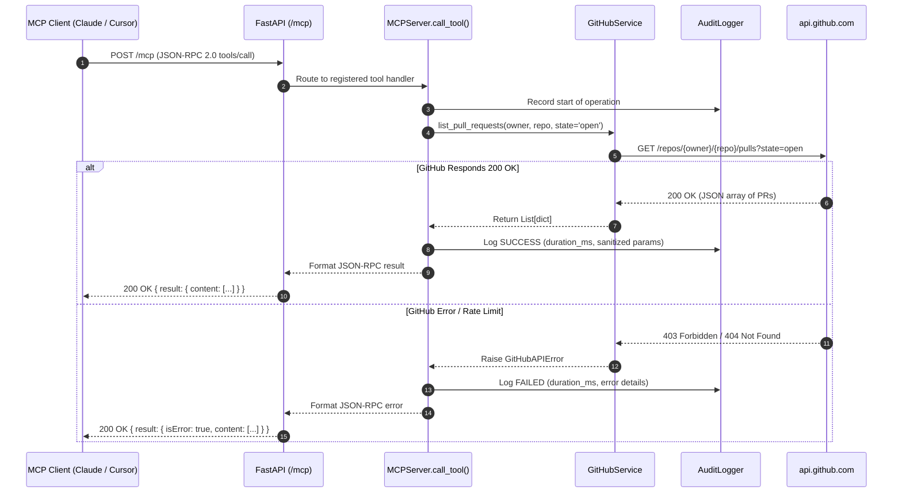
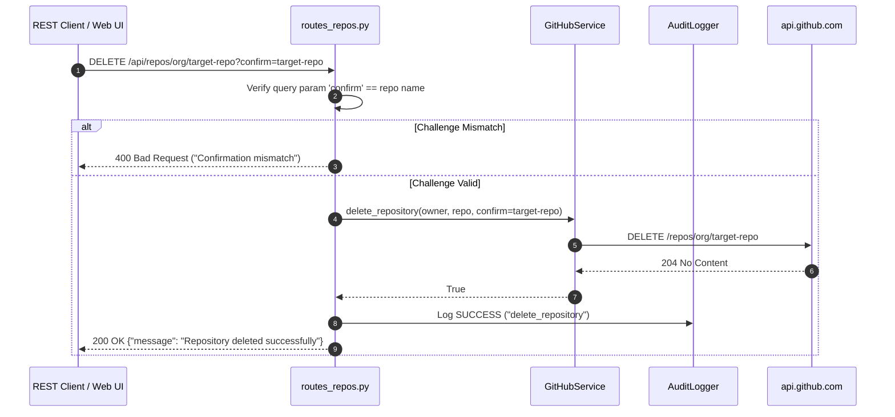
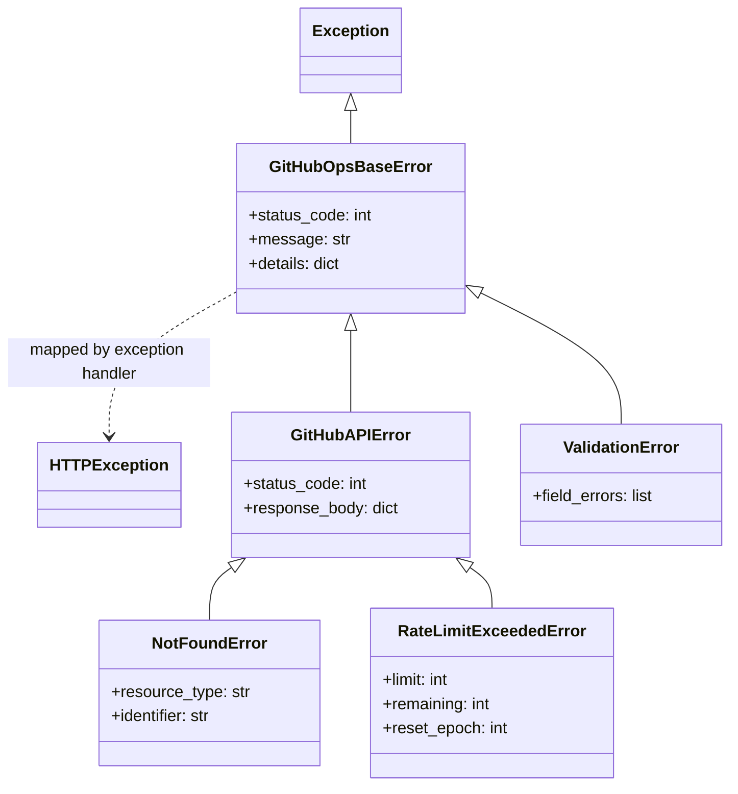

# GitHub Operations MCP Server & FastAPI Backend

A production-ready Python backend providing **Model Context Protocol (MCP)** tools and **FastAPI REST endpoints** for end-to-end GitHub operations management.

[](https://github.com/ravi-kundu7284/github-ops-mcp-server/actions)
[](https://www.python.org/downloads/)
[](https://modelcontextprotocol.io/)
[](https://fastapi.tiangolo.com)
[](LICENSE)

---

## 📑 Table of Contents

1. [High-Level Design (HLD)](#high-level-design-hld)
   - [System Context & Purpose](#system-context--purpose)
   - [Architectural Topology](#architectural-topology)
   - [Dual-Protocol Transport Layer (REST + MCP)](#dual-protocol-transport-layer-rest--mcp)
   - [Authentication & Token Resolution Flow](#authentication--token-resolution-flow)
   - [Security & Rate Limit Management](#security--rate-limit-management)
2. [Low-Level Design (LLD)](#low-level-design-lld)
   - [Class & Component Architecture](#class--component-architecture)
   - [Module & Directory Structure](#module--directory-structure)
   - [Thread-Safe Audit Ring Buffer](#thread-safe-audit-ring-buffer)
   - [Async Connection Pooling & Client Lifecycle](#async-connection-pooling--client-lifecycle)
   - [MCP Tool Registry & Contracts (22 Tools)](#mcp-tool-registry--contracts-22-tools)
   - [Sequence Diagrams](#sequence-diagrams)
   - [Error Handling & Exception Hierarchy](#error-handling--exception-hierarchy)
3. [REST API Reference](#rest-api-reference)
4. [Connecting MCP Clients (Claude Desktop, Cursor)](#connecting-mcp-clients-claude-desktop-cursor)
5. [Environment Variables](#environment-variables)
6. [Local Development & Testing](#local-development--testing)
7. [Docker & Production Deployment](#docker--production-deployment)
8. [CI/CD Pipeline](#cicd-pipeline)

---

## High-Level Design (HLD)

### System Context & Purpose

The `github-ops-mcp-server` serves as a unified GitHub operations gateway. It abstracts the GitHub REST API v3 into standard interfaces consumable simultaneously by:
- **Interactive Web SPAs** (such as `github-ops-ui`) via standard JSON REST endpoints.
- **Autonomous AI Agents & IDE Assistants** (Claude Desktop, Cursor, Custom Agents) via the Model Context Protocol (MCP).



### Architectural Topology

1. **FastAPI Application Core:** Acts as the outer HTTP server hosting REST endpoints, CORS policies, health probes, and mounting MCP sub-applications.
2. **MCP SDK Integration:** Uses `mcp.server.mcpserver.MCPServer` to register 22 tools. Transports are mounted at `/mcp` (Streamable HTTP) and `/sse` (Server-Sent Events).
3. **Async GitHub Service Layer:** Single source of truth for all GitHub operations. Manages client timeouts, bearer authorization, rate limit extraction, and error translation.
4. **Audit Logger Subsystem:** Captures telemetry for every tool invocation and REST request into a high-performance in-memory ring buffer.

### Dual-Protocol Transport Layer (REST + MCP)

| Capability | REST API (`/api/*`) | MCP Transports (`/mcp`, `/sse`) |
| :--- | :--- | :--- |
| **Primary Consumer** | React Frontend Dashboard | AI Agents, Claude Desktop, Cursor |
| **Protocol** | HTTP/1.1 or HTTP/2 JSON | JSON-RPC 2.0 over Streamable HTTP or SSE |
| **Discovery** | OpenAPI / Swagger UI at `/api/docs` | `tools/list` protocol capability |
| **Execution** | `GET`, `POST`, `PATCH`, `DELETE` | `tools/call` with arguments payload |
| **Input Validation**| Pydantic v2 Request Models | JSON Schema contracts derived from docstrings/types |
| **Telemetry** | Recorded to AuditLogger as `REST` | Recorded to AuditLogger as `MCP` |

### Authentication & Token Resolution Flow

The backend employs a three-tier fallback mechanism for acquiring GitHub tokens:



### Security & Rate Limit Management

- **Zero-Storage of Secrets:** Server-side logs and audit buffers never store plaintext tokens. Tokens pass ephemerally in HTTP headers.
- **Header Inspection:** Every response from `api.github.com` inspects `X-RateLimit-Limit`, `X-RateLimit-Remaining`, and `X-RateLimit-Reset`.
- **Destructive Operation Protection:** Operations like repository deletion require explicit verification challenge matching the repository name.

---

## Low-Level Design (LLD)

### Class & Component Architecture



### Module & Directory Structure

```
github-ops-mcp-server/
├── app/
│   ├── api/                        # REST API Router Endpoints
│   │   ├── deps.py                 # Dependency injection (token, service, audit)
│   │   ├── routes_auth.py          # /api/auth (user profile, rate-limits)
│   │   ├── routes_repos.py         # /api/repos (CRUD operations on repositories)
│   │   ├── routes_branches.py      # /api/repos/.../branches (listing, creation)
│   │   ├── routes_pulls.py         # /api/repos/.../pulls (PR lifecycle & reviews)
│   │   ├── routes_issues.py        # /api/repos/.../issues (issues & lifecycle)
│   │   ├── routes_commits.py       # /api/repos/.../commits (commit log & diffs)
│   │   ├── routes_contents.py      # /api/repos/.../contents (file editor & tree)
│   │   ├── routes_workflows.py     # /api/repos/.../actions (Actions runs & logs)
│   │   ├── routes_search.py        # /api/search (cross-GitHub search)
│   │   ├── routes_operations.py    # /api/operations (audit buffer inspection)
│   │   └── routes_mcp.py           # /api/mcp/info (MCP capabilities & tool list)
│   ├── mcp/
│   │   └── server.py               # MCPServer instance & 22 @mcp_server.tool definitions
│   ├── models/
│   │   └── schemas.py              # Pydantic v2 request & response schemas
│   ├── services/
│   │   ├── github_service.py       # Async HTTPX GitHub client engine
│   │   └── audit.py                # Thread-safe in-memory circular audit buffer
│   ├── config.py                   # Pydantic BaseSettings environment manager
│   └── main.py                     # FastAPI application factory & router registration
├── tests/
│   ├── conftest.py                 # Pytest fixtures & mock clients
│   ├── test_api_repos.py           # REST API unit & integration tests
│   ├── test_audit.py               # Audit ring buffer thread-safety tests
│   ├── test_github_service.py      # Service layer error handling tests
│   └── test_mcp_server.py          # MCP tool registration & schema tests
├── Dockerfile                      # Multi-stage production container build
├── pyproject.toml                  # Project metadata & Ruff configuration
└── requirements.txt                # Production dependency requirements
```

### Thread-Safe Audit Ring Buffer

The `AuditLogger` is implemented in `app/services/audit.py` with an internal `collections.deque(maxlen=MAX_AUDIT_LOGS)`:
1. **Thread-Safe Mutation:** All `log()`, `get_records()`, and `clear()` operations acquire a reentrant `threading.Lock()` to prevent race conditions during concurrent async worker execution.
2. **Recursive Secret Sanitization:** The `_sanitize` method traverses dictionaries, lists, and primitives, replacing any key matching `token`, `secret`, `authorization`, `password`, or `key` with `***REDACTED***`.
3. **Ring Buffer Semantics:** Once the queue reaches `MAX_AUDIT_LOGS` (default: 500), new items push the oldest entries out in $O(1)$ constant time.

### Async Connection Pooling & Client Lifecycle

`GitHubService` maintains an async `httpx.AsyncClient` with connection pooling:
- **Keep-Alive Pool:** Limits established HTTP connections to avoid socket exhaustion.
- **Timeout Envelopes:** Granular 15-second connect and 30-second read timeouts prevent stalled connections during GitHub platform spikes.
- **Lifecycle Integration:** Created during FastAPI's `@asynccontextmanager` startup lifespan and closed during shutdown.

### MCP Tool Registry & Contracts (22 Tools)

The backend registers 22 granular tools conforming to the Model Context Protocol:

| # | Tool Identifier | Signature & Parameters | Description |
|---|-----------------|------------------------|-------------|
| 1 | `list_repositories` | `(visibility='all', sort='updated', direction='desc', per_page=30, page=1)` | Lists user and accessible organization repositories. |
| 2 | `get_repository` | `(owner: str, repo: str)` | Fetches detailed repository metadata, topics, and metrics. |
| 3 | `create_repository` | `(name: str, description='', private=False, auto_init=True)` | Creates a new GitHub repository under authenticated account. |
| 4 | `update_repository` | `(owner: str, repo: str, name='', description='', private=None)` | Modifies repository settings, description, or visibility. |
| 5 | `delete_repository` | `(owner: str, repo: str, confirm=False)` | Deletes a repository permanently (**confirm=True required**). |
| 6 | `list_branches` | `(owner: str, repo: str, per_page=30, page=1)` | Lists branches with protection status and latest commit SHAs. |
| 7 | `create_branch` | `(owner: str, repo: str, branch: str, from_branch='main')` | Creates a new branch from a branch ref or commit SHA. |
| 8 | `list_pull_requests` | `(owner: str, repo: str, state='open', sort='created', per_page=30, page=1)` | Lists pull requests filtered by state. |
| 9 | `create_pull_request` | `(owner: str, repo: str, title: str, head: str, base='main', body='', draft=False)` | Opens a new pull request. |
| 10 | `review_pull_request` | `(owner: str, repo: str, pull_number: int, event='APPROVE', body='')` | Submits a PR review (`APPROVE`, `REQUEST_CHANGES`, `COMMENT`). |
| 11 | `merge_pull_request` | `(owner: str, repo: str, pull_number: int, commit_title='', merge_method='merge')` | Merges PR via `merge`, `squash`, or `rebase`. |
| 12 | `list_issues` | `(owner: str, repo: str, state='open', labels='', per_page=30, page=1)` | Lists issues (excluding pull requests). |
| 13 | `create_issue` | `(owner: str, repo: str, title: str, body='', assignees=[], labels=[])` | Creates an issue with assignees and labels. |
| 14 | `update_issue` | `(owner: str, repo: str, issue_number: int, title='', body='', state='')` | Updates issue title, body, state, or labels. |
| 15 | `close_issue` | `(owner: str, repo: str, issue_number: int, comment='')` | Closes an issue with an optional resolution comment. |
| 16 | `list_commits` | `(owner: str, repo: str, sha='', path='', author='', per_page=30, page=1)` | Lists commit history with author metadata and dates. |
| 17 | `get_file_contents` | `(owner: str, repo: str, path: str, ref='main')` | Reads file content (Base64 decoded) or lists directory entries. |
| 18 | `create_or_update_file` | `(owner: str, repo: str, path: str, message: str, content: str, sha='', branch='main')` | Commits changes to a file or creates a new file. |
| 19 | `list_workflows` | `(owner: str, repo: str)` | Lists defined GitHub Actions workflows in `.github/workflows`. |
| 20 | `get_workflow_runs` | `(owner: str, repo: str, workflow_id='', status='', per_page=30, page=1)` | Fetches workflow execution history and run conclusions. |
| 21 | `get_workflow_run_logs` | `(owner: str, repo: str, run_id: int)` | Retrieves jobs, steps, and download URLs for run logs. |
| 22 | `search_github` | `(query: str, search_type='repositories', per_page=30, page=1)` | Global search across repos, issues, PRs, commits, and code. |

### Sequence Diagrams

#### MCP Tool Execution (Streamable HTTP)



#### Destructive Action Flow (Delete Repository)



### Error Handling & Exception Hierarchy



---

## REST API Reference

The interactive Swagger UI is available at `/api/docs`. Key routes include:

- **Health & MCP Metadata:**
  - `GET /health` - Health status and connection check
  - `GET /api/mcp/info` - MCP tool schemas and transport status
  - `GET /api/auth/status` - Authenticated user details
  - `GET /api/auth/ratelimit` - Rate limit metrics (remaining, limit, reset)
- **Repositories:**
  - `GET /api/repos` - List repositories
  - `POST /api/repos` - Create repository
  - `GET /api/repos/{owner}/{repo}` - Repository details
  - `PATCH /api/repos/{owner}/{repo}` - Update repository
  - `DELETE /api/repos/{owner}/{repo}` - Delete repository (requires `confirm=repo_name`)
- **Branches:**
  - `GET /api/repos/{owner}/{repo}/branches` - List branches
  - `POST /api/repos/{owner}/{repo}/branches` - Create branch
- **Pull Requests:**
  - `GET /api/repos/{owner}/{repo}/pulls` - List PRs
  - `POST /api/repos/{owner}/{repo}/pulls` - Create PR
  - `GET /api/repos/{owner}/{repo}/pulls/{number}` - PR details
  - `POST /api/repos/{owner}/{repo}/pulls/{number}/reviews` - Submit review
  - `PUT /api/repos/{owner}/{repo}/pulls/{number}/merge` - Merge PR
- **Issues:**
  - `GET /api/repos/{owner}/{repo}/issues` - List issues
  - `POST /api/repos/{owner}/{repo}/issues` - Create issue
  - `GET /api/repos/{owner}/{repo}/issues/{number}` - Issue details
  - `POST /api/repos/{owner}/{repo}/issues/{number}/close` - Close issue
- **Commits & Contents:**
  - `GET /api/repos/{owner}/{repo}/commits` - Commit history
  - `GET /api/repos/{owner}/{repo}/commits/{sha}` - Commit details & diff
  - `GET /api/repos/{owner}/{repo}/contents/{path}` - Read file or directory
  - `PUT /api/repos/{owner}/{repo}/contents/{path}` - Create or update file
- **Workflows & Actions:**
  - `GET /api/repos/{owner}/{repo}/actions/workflows` - List workflows
  - `GET /api/repos/{owner}/{repo}/actions/runs` - Workflow runs
  - `GET /api/repos/{owner}/{repo}/actions/runs/{run_id}/logs` - Run logs & steps
- **Search & Audit:**
  - `GET /api/search?q={query}&type={type}` - Global search
  - `GET /api/operations` - List audit records
  - `DELETE /api/operations` - Clear audit records

---

## Connecting MCP Clients (Claude Desktop, Cursor)

### Streamable HTTP Transport
```json
{
  "mcpServers": {
    "github-ops": {
      "url": "http://localhost:8000/mcp"
    }
  }
}
```

### Server-Sent Events (SSE) Transport
```json
{
  "mcpServers": {
    "github-ops": {
      "url": "http://localhost:8000/sse"
    }
  }
}
```

---

## Environment Variables

| Variable | Default | Description |
| :--- | :--- | :--- |
| `GITHUB_TOKEN` | *None* | Default GitHub Personal Access Token (classic or fine-grained) |
| `GITHUB_API_URL` | `https://api.github.com` | Base GitHub REST API URL |
| `APP_HOST` | `0.0.0.0` | Host binding for server |
| `APP_PORT` | `8000` | Port binding |
| `ENVIRONMENT` | `development` | Deployment environment (`development` / `production`) |
| `LOG_LEVEL` | `INFO` | Logging verbosity |
| `CORS_ORIGINS` | `http://localhost:5173,http://localhost:3000` | Comma-separated list of allowed origins |
| `API_KEY` | *None* | Optional API Key for securing backend endpoints |
| `MCP_SERVER_NAME`| `github-ops-mcp-server` | MCP Server identification |
| `MAX_AUDIT_LOGS` | `500` | In-memory audit buffer size |

---

## Local Development & Testing

```bash
# 1. Setup virtual environment
python -m venv .venv
source .venv/bin/activate  # On Windows: .venv\Scripts\activate

# 2. Install dependencies
pip install -r requirements-dev.txt

# 3. Configure environment
cp .env.example .env

# 4. Start local development server
python -m uvicorn app.main:app --host 0.0.0.0 --port 8000 --reload

# 5. Run tests & linters
pytest -v
ruff check app tests
```

---

## Docker & Production Deployment

```bash
# Build Docker image
docker build -t github-ops-mcp-server:latest .

# Run container
docker run -d -p 8000:8000 \
  -e GITHUB_TOKEN=ghp_your_token \
  -e CORS_ORIGINS=https://your-ui-domain.com \
  --name mcp-backend github-ops-mcp-server:latest
```

---

## CI/CD Pipeline

The `.github/workflows/ci.yml` pipeline runs on every push and PR to `main`:
1. **Linting:** Validates code quality and PEP 8 compliance via Ruff (`ruff check app tests`).
2. **Matrix Testing:** Runs test suite on Python 3.11 and 3.12 with Pytest.
3. **Container Build:** Validates multi-stage Docker build.
